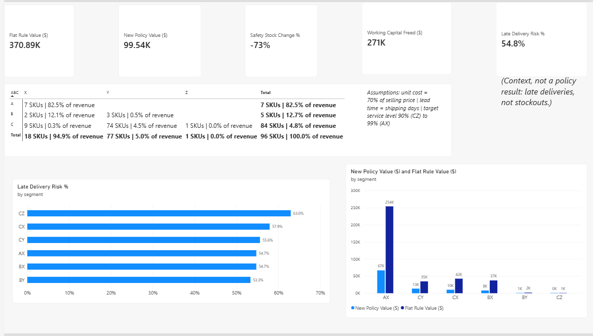
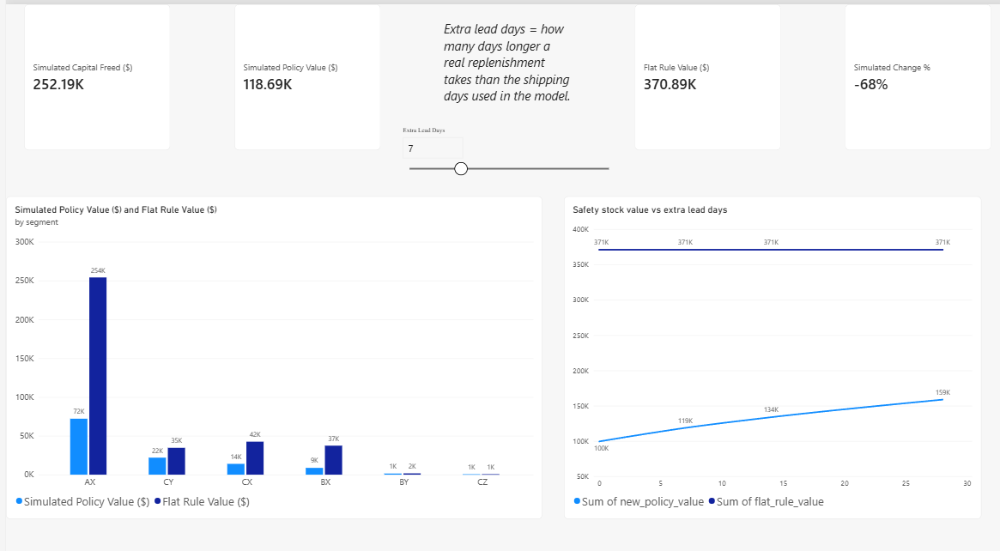
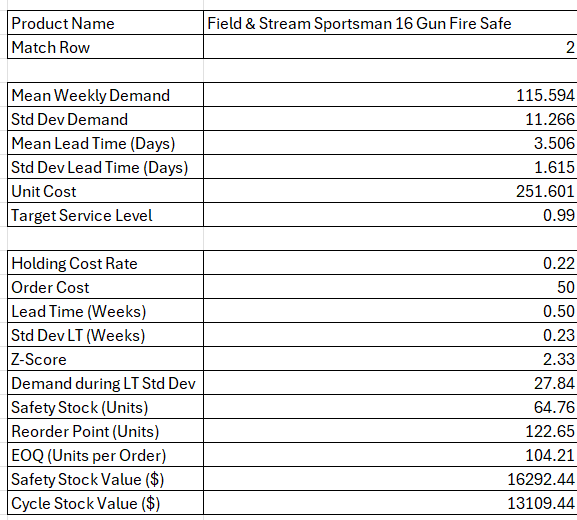
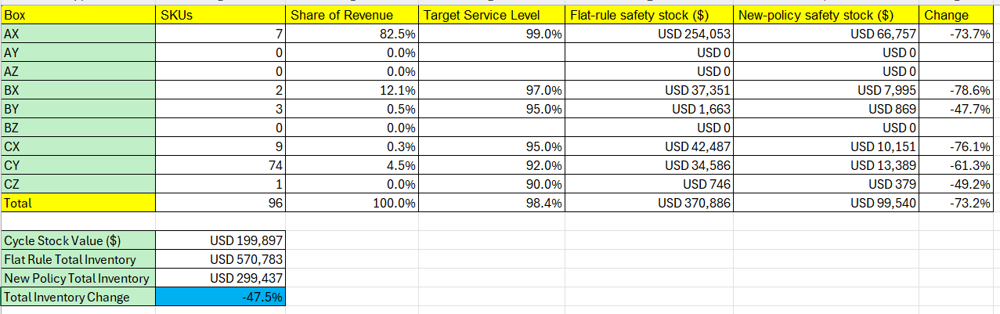

# ABC-XYZ Inventory Segmentation and Safety Stock Optimization

This project sorts the SKUs of the DataCo Smart Supply Chain dataset into nine ABC-XYZ boxes, sets a service level for each box, and compares the resulting safety stock with the common flat "15 days of inventory" rule. The work is done in Python and SQL, and shown in a Power BI dashboard and an Excel calculator.

**Result:** on the 96 SKUs with a policy, the safety stock value falls by 73% ($370,886 to $99,540), which frees about $271,300 of working capital. If real replenishment takes 28 days longer than the shipping days used here, the new policy still holds 57% less safety stock than the flat rule. That comparison is no longer like-for-like, though: at that lead time the flat rule misses the service target for 60 SKUs (see the lead-time table below).

**Tools:** Python (pandas, NumPy), SQL (SQLite window functions), Excel, Power BI.



## Business problem

Planners often use one flat buffer, 15 days of average demand, for every SKU. That ignores two things: how much revenue a SKU brings in (ABC) and how erratic its demand is (XYZ). This project replaces the flat rule with a policy that depends on both, and measures how much safety stock that frees up.

## Main results

These results depend on the assumptions listed further down. They use the original DataCo file with 180,519 rows.

- 100 SKUs had sales in the analysis window (2015-01-05 to 2017-09-25, 143 weeks). 4 of them have only one week of history, so no standard deviation and no policy can be computed. The other **96 SKUs** are in the results.
- Safety stock value drops by **73%**: $99,540 under the new policy against $370,886 under the flat rule. That frees about $271,300 of working capital.
- Including cycle stock (EOQ / 2), total average inventory drops by **48%**: $299,437 against $570,783.
- 7 AX SKUs bring in 82.5% of revenue. No A SKU is erratic: the AY and AZ boxes are empty (so is BZ).
- In every box the flat rule gives an estimated median service level of 99.4% to 100%, against targets of 90% to 99%. With the shipping days used as lead time, it over-protects every box and falls short of the target for no SKU. That changes if real lead times are longer: with 14 extra days it misses the target for 11 SKUs, and with 28 extra days for 60 (lead-time table below). One reason the saving is large: the flat rule holds 15 days of average demand, about four times the 3.5-day shipping lead time used here.
- Late-delivery risk is the share of order lines with `Late_delivery_risk` = 1. It is 54.8% on the whole original file. In the five boxes with more than one SKU it runs from 53.3% (BY) to 57.9% (CX), with AX 54.7%, BX 54.7% and CY 55.6%. CZ, with a single SKU, is at 63.0%. The ABC-XYZ box does not explain it, and it records late deliveries, not stockouts.

| Box | SKUs | Share of revenue | Target service level | Flat rule service level (median) | Flat rule safety stock ($) | New policy safety stock ($) | Change |
|---|---|---|---|---|---|---|---|
| AX | 7 | 82.5% | 99% | 100.0% | 254,053 | 66,757 | -74% |
| BX | 2 | 12.1% | 97% | 100.0% | 37,351 | 7,995 | -79% |
| BY | 3 | 0.5% | 95% | 99.9% | 1,663 | 869 | -48% |
| CX | 9 | 0.3% | 95% | 100.0% | 42,487 | 10,151 | -76% |
| CY | 74 | 4.5% | 92% | 100.0% | 34,586 | 13,389 | -61% |
| CZ | 1 | 0.04% | 90% | 99.4% | 746 | 379 | -49% |
| Total | 96 | 100% | | | 370,886 | 99,540 | -73% |

Share of revenue is measured on the 96 SKUs with a policy. The ABC ranking itself uses all 100 SKUs.

### What if real lead time is longer than the shipping days used here?

| Extra lead days | New policy safety stock ($) | Change against the flat rule | SKUs where the flat rule misses its target |
|---|---|---|---|
| 0 | 99,540 | -73% | 0 |
| 7 | 118,693 | -68% | 0 |
| 14 | 133,789 | -64% | 11 (1.2% of revenue) |
| 28 | 158,711 | -57% | 60 (4.3% of revenue) |

The flat rule stays at $370,886 in every row, because it ignores lead time. The saving shrinks as lead time grows, and the last two rows are not like-for-like: with up to 7 extra days the flat rule still reaches the target service level for every SKU, but with 14 or 28 extra days it falls short for some SKUs, all of them in the CY, BY and CZ boxes. With 28 extra days the new policy holds slightly more safety stock than the flat rule in those three boxes together (CY alone: about $37,100 against $34,586), so the whole saving comes from AX, BX and CX, where the flat rule still meets the target. A SKU "misses its target" when the estimated service level of the flat rule for it is below the target of its box.

## Method

1. **Cleaning.** The script drops repeated order item ids, rows with a missing product name, rows with a missing product id, quantity, price or discount, rows with a zero or negative quantity or price or a negative discount, and rows with an unreadable order date. Cancelled and suspected-fraud orders are left out of demand. Net revenue of an order line = price x quantity - discount.
2. **Weekly demand.** Units per SKU per week (weeks start on Monday). The window runs from the first to the last "normal" week (at least half of the median weekly volume), so the thin edges of the data are left out. From a SKU's first sale on, weeks without sales count as 0.
3. **ABC, in SQL.** SKUs are ranked by revenue and a running revenue share is computed with a window function. A: SKUs whose share of cumulative revenue before adding them is below 80%, so the SKU that crosses 80% is still in A. B: below 95%. C: the rest. The ranking uses all 100 SKUs with sales in the window, including the 4 with only one week of history.
4. **XYZ.** CV = standard deviation / mean of weekly units. X: CV up to 0.5. Y: up to 1.0. Z: above 1.0. The SQL query uses a calendar spine and a LEFT JOIN, so weeks without orders count as 0. A second, independent calculation in pandas agrees with the SQL on all 100 SKUs. The 4 SKUs with one week of history have no standard deviation, so the last branch of the query labels them Z. The Python code drops them before any policy is calculated, which is why the tables in this README hold 96 SKUs.
5. **Policy per SKU.**
   - Safety stock = Z x sqrt( L x sigma_D^2 + D^2 x sigma_L^2 ), where D is demand in units per week, sigma_D its standard deviation, L is lead time in weeks, sigma_L its standard deviation, and Z comes from the target service level of the box.
   - Reorder point = D x L + safety stock.
   - EOQ = sqrt( 2 x annual demand x order cost / (holding rate x unit cost) ), with annual demand = 52 x D.
   - The flat rule used for comparison is: safety stock = 15 days of average demand.

## Assumptions

The cost, flat-rule and service-level assumptions are written in capital letters at the top of Cell 4 of the script and can be changed. The XYZ limits (0.5 and 1.0) are in Cell 3.

| Assumption | Value | Why |
|---|---|---|
| Unit cost | 70% of net selling price | The dataset has no cost column |
| Holding cost | 22% of inventory value per year | Typical range is 18% to 25% |
| Order cost | $50 per order | The dataset has no order cost |
| Flat rule | 15 days of average demand | Baseline from the project brief |
| Lead time | Each SKU's mean and standard deviation of actual shipping days | The dataset has no supplier lead time |
| Target service level | AX 99%, AY 98%, AZ 97%, BX 97%, BY 95%, BZ 93%, CX 95%, CY 92%, CZ 90% | Higher for valuable and predictable SKUs |

## Limitations

- Shipping days to the customer are only a stand-in for supplier lead time. The lead-time table above shows what happens if replenishment is slower.
- Of the 96 SKUs, 42 have less than 26 weeks of sales history and 45 had no sale in the last 13 weeks of the window. All 45 of those last sold in April 2017, which looks like a change in the product catalogue. Only the 9 SKUs in AX and BX have neither problem. The 87 SKUs outside AX and BX bring in 5.4% of revenue, so the totals hold up, but their individual policies are less reliable.
- For a SKU that stopped selling, the zero weeks after its last sale count as zero demand. That raises its CV, so it can look more erratic than it was while it sold. A SKU close to a cut-off can also change box when the data change slightly: SKU 303 (Garmin Forerunner 910XT GPS Watch) has a CV of 0.481 against the 0.5 limit, and SKU 44 (adidas Men's F10 Messi TRX FG Soccer Cleat) sits right at the 95% revenue line.
- The safety stock formula assumes roughly normal demand. That is a rough fit for the 74 CY SKUs, which sell about 6 units a week.
- The service levels are targets from theory. No stockout simulation was run, so fill rate is not measured.
- All dollar values depend on the cost assumptions above.
- Product names are shown as they come in the DataCo file, which cuts long names at 45 characters, so some of them end in the middle of a word (for example in `policy_by_sku.csv`). The script does not repair them.
- Each SKU is planned on its own at a single stocking point (single-echelon). There is no network of warehouses and suppliers here, so this is not a multi-echelon model.

## Power BI dashboard

`abc_xyz_inventory_dashboard.pbix` has two pages:

- **Page 1:** the 9-box matrix (SKU count and revenue share per box), cards for safety stock value under the flat rule and under the new policy, the change in percent, the working capital freed and the late-delivery risk, a chart of both safety stock values by box and a chart of late-delivery risk by box. Click a box and everything filters to it.
- **Page 2 (what-if):** a slider for extra lead days. The safety stock value under the new policy is recalculated for every SKU as you move it, next to the Python result for 0, 7, 14 and 28 days.

The late-delivery figures come from two columns of the original CSV (`Product Card Id` and `Late_delivery_risk`), counted per SKU. The original file is not in this repository, so refreshing those visuals in Power BI needs your own copy of it.



## Excel calculator

`abc_xyz_rop_calculator.xlsx` has three sheets:

- **Data:** the file `policy_by_sku.csv` written by the Python script.
- **Calculator:** choose a product. The sheet looks up its average weekly demand and standard deviation, its lead time and standard deviation, its unit cost and its target service level. With the holding cost rate (22%) and the order cost ($50) it calculates the Z-score, safety stock, reorder point, EOQ and cycle stock value.
- **Portfolio:** the nine boxes, flat rule against new policy, and total inventory including cycle stock. The totals agree with the Python results.

The calculator works from the values rounded to three decimals in `policy_by_sku.csv`, so the result for a single SKU can differ from the CSV's own columns by a fraction of a percent (for the fire safe in the screenshot: 64.76 units in Excel, 64.74 in the CSV).




## Files

| File | What it is |
|---|---|
| `abc_xyz_safety_stock.py` | Python script: cleaning, weekly demand, ABC-XYZ in SQL, safety stock, reorder point, EOQ |
| `abc_xyz.sql` | The ABC-XYZ classification query (window functions and a calendar spine). It holds its own parameters and reads `weekly_sales.csv`, so it also runs without Python (see [Run only the SQL](#run-only-the-sql)); the script runs this same query and writes the file |
| `policy_by_sku.csv` | One row per SKU: box, demand statistics, safety stock, reorder point, EOQ and values |
| `segment_summary.csv` | One row per box: flat rule against new policy |
| `lead_time_sensitivity.csv` | The comparison with 0, 7, 14 and 28 extra lead days, with the number of SKUs where the flat rule misses its target |
| `weekly_demand_long.csv` | Weekly units (sku, week, units) for all 100 SKUs with sales: the 96 with a policy and the 4 with one week of history. Each SKU starts at its first sale, and zero-demand weeks are included (for Power BI) |
| `weekly_sales.csv` | The input of `abc_xyz.sql`: units and revenue for each SKU and week with sales (sku, week, units, revenue), all 100 SKUs |
| `abc_xyz_inventory_dashboard.pbix` | The Power BI dashboard |
| `abc_xyz_rop_calculator.xlsx` | The Excel calculator |
| `dashboard_9box.png`, `dashboard_whatif.png`, `excel_calculator.png`, `excel_portfolio.png` | Screenshots used in this README |
| `requirements.txt` | Python packages needed to run the script |
| `LICENSE` | MIT License |

## How to reproduce

1. Download the dataset from Kaggle: [DataCo Smart Supply Chain for Big Data Analysis](https://www.kaggle.com/datasets/shashwatwork/dataco-smart-supply-chain-for-big-data-analysis). Its authors and license are credited under [Data source and license](#data-source-and-license). It is not in this repository because of its size. The original file has 180,519 rows.
2. Open a Google Colab or Jupyter notebook and upload the dataset and `abc_xyz_safety_stock.py`. Colab already has pandas and NumPy; on your own machine run `pip install -r requirements.txt` first.
3. Load the original file into a DataFrame called `df`:

   ```python
   import pandas as pd
   df = pd.read_csv("DataCoSupplyChainDataset.csv", encoding="latin-1")
   ```

4. Run the script in the same notebook. The `-i` lets the script see `df`:

   ```python
   %run -i abc_xyz_safety_stock.py
   ```

   It prints the results and writes `policy_by_sku.csv`, `segment_summary.csv`, `lead_time_sensitivity.csv`, `weekly_demand_long.csv`, `weekly_sales.csv` and `abc_xyz.sql`. It also writes `lines_clean.pkl`, a working copy of the cleaned order lines that is not part of this repository (`.gitignore` keeps it out).
5. Compare the printout with this README. The first 9-box counts all 100 SKUs with sales (the 4 SKUs with one week of history sit in the Z column). Everything after that uses the 96 SKUs with a policy: safety stock 370,886 against 99,540 (-73%) and total inventory 570,783 against 299,437 (-48%).
6. Open `abc_xyz_inventory_dashboard.pbix` in Power BI Desktop and `abc_xyz_rop_calculator.xlsx` in Excel.

### Run only the SQL

`abc_xyz.sql` needs neither Python nor the DataCo file, only SQLite 3.35 or newer and `weekly_sales.csv`. With the sqlite3 command-line tool, in the folder that holds both files:

```bash
sqlite3 -csv -header :memory: "CREATE TABLE weekly (sku INTEGER, week TEXT, units INTEGER, revenue REAL);" ".import --skip 1 weekly_sales.csv weekly" ".read abc_xyz.sql"
```

It prints one row per SKU (100 rows): revenue, cumulative revenue share, ABC class, weeks of history, mean and standard deviation of weekly units, CV and XYZ class. The first and last Monday of the window and the CV limits are in the `params` block at the top of the query. The 4 SKUs with one week of history come out as Z with an empty CV (see Method, step 4). In DB Browser for SQLite, import `weekly_sales.csv` as a table named `weekly` and paste the query into the Execute SQL tab.

## Data source and license

**Data.** The analysis uses the DataCo Smart Supply Chain dataset, published on Mendeley Data under the [Creative Commons Attribution 4.0 International license (CC BY 4.0)](https://creativecommons.org/licenses/by/4.0/):

> Constante, Fabian; Silva, Fernando; Pereira, António (2019), "DataCo SMART SUPPLY CHAIN FOR BIG DATA ANALYSIS", Mendeley Data, V5, doi: [10.17632/8gx2fvg2k6.5](https://doi.org/10.17632/8gx2fvg2k6.5)

The original file is not part of this repository. The CSV files here are derived from it and were changed: orders were cleaned, cancelled and suspected-fraud orders were left out, and the rest was summed per SKU (and per SKU and week for `weekly_demand_long.csv` and `weekly_sales.csv`). They contain no order lines.

**Code.** Released under the MIT License (see `LICENSE`).
